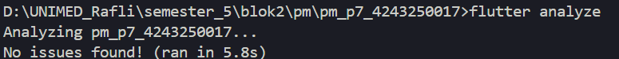
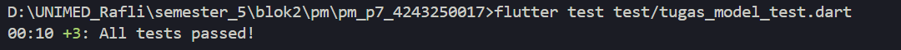
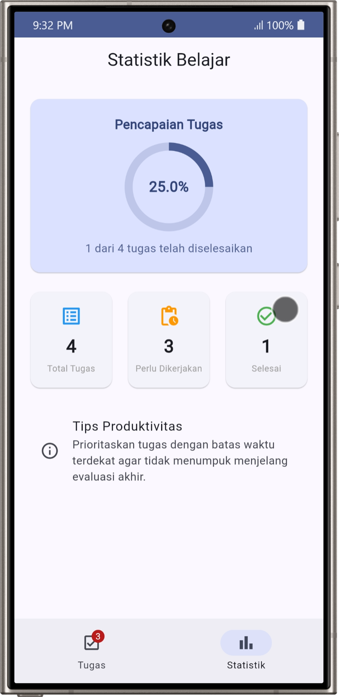
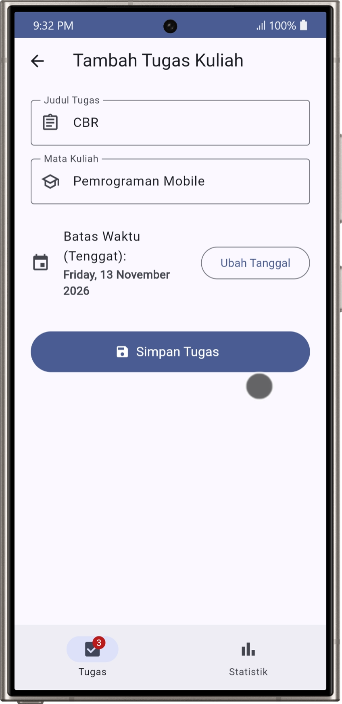
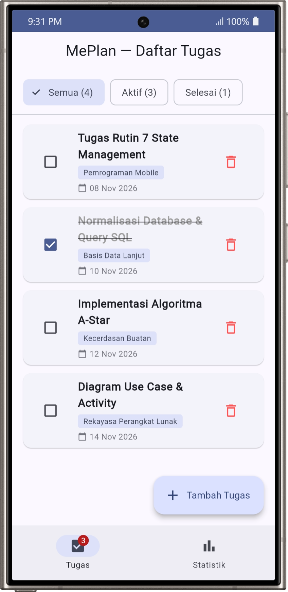
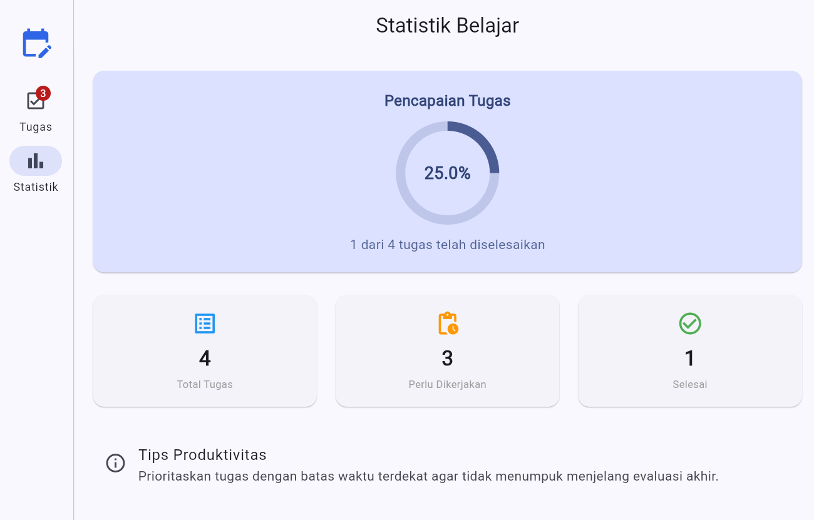
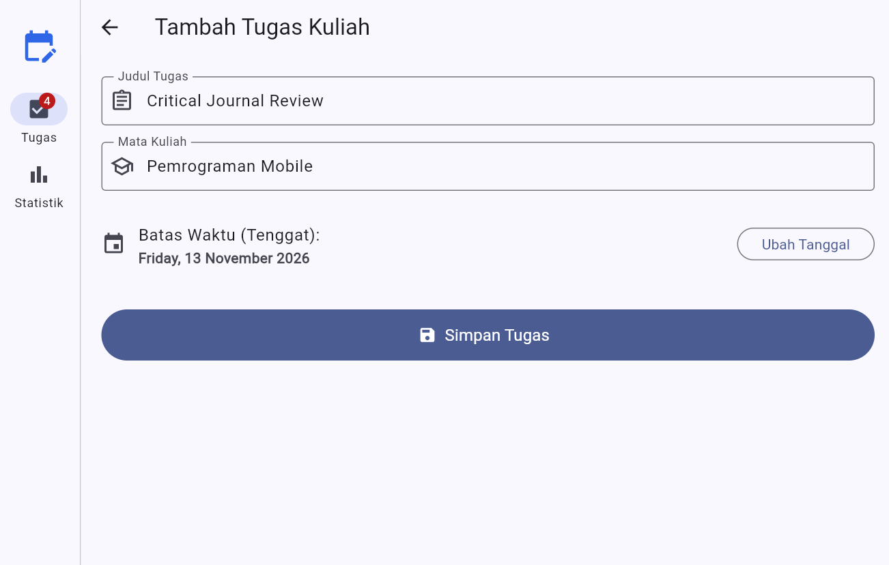
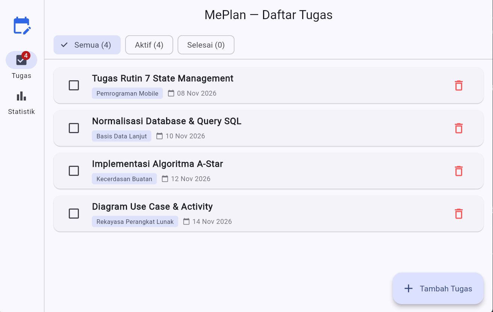

### Pertmuan 7
### A. Identitas
- Nama: Muhammad Rafli Wijaya
- NIM: 4243250017
- Kelas: PSIK 24D
- Mata Kuliah: Pemrograman Mobile

### B. Screenshot
- Flutter Analyze

- Flutter Test

- Mobile: Statistik

- Mobile: Tambah Tugas

- Mobile: List Tugas

- Tab: Statistik

- Tab: Tambah Tugas

- Tab: List Tugas

### C. Diagram
┌─────────────────────────────────────────────────────────────┐
│                       ROOT APLIKASI                         │
│             ChangeNotifierProvider(TugasModel)              │
│               [ APP STATE / STATE BERSAMA ]                 │
│         - List<TugasKuliah> (tambah, toggle, hapus)         │
│         - jumlahTotal, jumlahSelesai, jumlahAktif           │
└──────────────────────────────┬──────────────────────────────┘
                               │
       ┌───────────────────────┼───────────────────────┐
       ▼                       ▼                       ▼
┌──────────────────┐  ┌──────────────────┐  ┌──────────────────┐
│  Halaman Daftar  │  │   Halaman Form   │  │ HalamanStatistik │
│ [EPHEMERAL STATE]│  │ [EPHEMERAL STATE]│  │                  │
│ FilterChip:      │  │ TextEditing-     │  │ Membaca:         │
│ Semua/Aktif/     │  │ Controller di    │  │ total, selesai,  │
│ Selesai via      │  │ initState &      │  │ persentase       │
│ setState         │  │ dispose          │  │ otomatis berubah │
└──────────────────┘  └──────────────────┘  └──────────────────┘
Alasan Pemisahan State:
- App State (Bersama via Provider): Daftar tugas dan statistik harus diakses dan diubah oleh berbagai halaman yang terpisah rute go_router. Perubahan status tugas di halaman daftar harus otomatis memperbarui badge navigasi dan persentase di halaman statistik secara bersamaan.
- Ephemeral State (Lokal via setState): Status filter Semua/Aktif/Selesai di halaman daftar dan teks yang sedang diketik pada form hanya dibutuhkan oleh widget itu sendiri, sehingga cukup dikelola lokal dengan setState supaya render lebih efisien.

### D. Penjelasan Pemilihan Provider
Dalam pengembangan aplikasi MePlan ini, siklus hidup (lifecycle) StatefulWidget diterapkan pada HalamanFormTambah. Pengendali input teks (TextEditingController) diinisialisasi pada metode initState(). Metode ini hanya dieksekusi satu kali saat widget pertama kali dimasukkan ke dalam pohon widget (widget tree), untuk menjamin bahwa pengontrol siap menerima masukan pengguna. Selanjutnya, kedua controller wajib dibersihkan pada metode dispose() dengan memanggil _controller.dispose(). Langkah ini penting untuk mencegah kebocoran memori, karena objek controller yang tidak dibuang akan terus berada di memori meskipun pengguna telah berpindah layar.

Saya memilih Provider (ChangeNotifier) sebagai solusi state management bersama karena pendekatan ini menawarkan keseimbangan yg optimal antara keterbacaan kode (readability) dan performa. Dibandingkan dengan Cubit/BLoC yang membutuhkan definisi event/state class terpisah (boilerplate tinggi), Provider memungkinkan pemusatan logika bisnis dalam satu kelas model yang bersih. Konsumsi data di UI dioptimalkan menggunakan context.select pada badge navigasi agar hanya membangun ulang (rebuild) saat jumlah tugas aktif berubah.

### Informasi Tambahan
Untuk pratikum pertemuan 7 ada pada repository "pm_p6_pratikum_4243250017" di gabung dengan pratikum pertemuan 6

### E. Pernyataan Penggunaan AI
Saya menggunakan ai untuk membuat kerangka awal / template dari tugas ini, kemudian meminta intruksinya harus berisi apa file ini, kemudian bagaimana gambaran struktur file yg diperlukan, jika sudah buntu, saya meminta ai untuk generate kode nya kemudian mengetik ulang kode tersebut. saya juga menggunakan ai untuk membuat penjelasan yg lebih to the poin untuk readme dan diagram pada poin C.